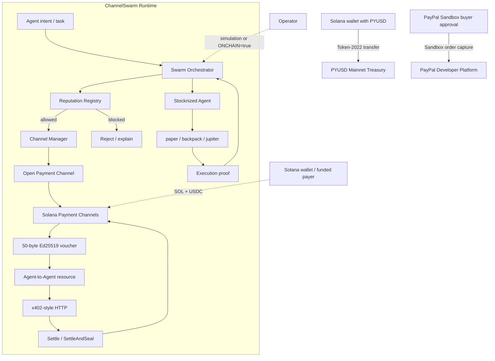

# ⚡ ChannelSwarm

> **Autonomous Agent Economy on Solana**

<div align="center">

**Agents that can earn · spend · coordinate · settle**

[](https://solana.com/)
[](https://www.typescriptlang.org/)
[](https://github.com/wadezigh96/Channel_Swarm/actions)
[](LICENSE)

[**Live Dashboard**](https://swarm-agent-beta.vercel.app/) · [**Payment Channels Program**](https://explorer.solana.com/address/CHNLxYvVA28MJP9PrFuDXccuoGXAx7jBacfLEkahyGsX) · [**Submission**](SUBMISSION.md)

</div>

---

## 🧠 What is ChannelSwarm?

**ChannelSwarm** is a Solana-native prototype for agent-to-agent payments.

It combines:

- ⚡ **Payment Channels** — signed cumulative vouchers for micropayments
- 🤖 **Agent Swarm** — payer, oracle and trading agents coordinating together
- 🧠 **Vercel AI Gateway** — server-side intent routing that proposes an agent/action; it cannot execute payments or trades
- 💰 **PayPal Checkout (Sandbox)** — buyer approval, server-side order capture, and verified webhooks
- 🪙 **PYUSD Mainnet** — wallet-signed Token-2022 transfers of PayPal USD on Solana Mainnet
- 🛡️ **Reputation** — score-gated agent participation
- 💳 **x402-style payments** — HTTP payment-required flow using signed vouchers
- 📈 **Stocknized Agent** — tokenized-equity strategy with **paper default** and **opt-in live execution** (Backpack RFQ or Jupiter xStock swaps)

> **Honest status:** payment-channel wire format and demo lifecycle are implemented. Tokenized-equity **execution path** is complete (paper / backpack / jupiter) with local execution proofs; live fills require credentials and funded accounts. Production persistence remains in-memory.

---

## ✨ Product Surface

| Module | What it does |
|---|---|
| **Agent Economy** | Coordinates Alpha, DataOracle and StockHunter |
| **Payment Channels** | Existing USDC channel escrow and signed cumulative vouchers remain intact |
| **PYUSD Checkout** | Direct PayPal USD Token-2022 transfer to a configured Solana Mainnet treasury |
| **Settlement** | Builds `settle`, `settleAndSeal` and close instructions |
| **x402-style HTTP** | Returns `402 Payment Required` and verifies signed payments |
| **Reputation** | Gates participation using agent reputation |
| **Stocknized** | Pyth (or paper) quotes + `EXECUTION_MODE=paper\|backpack\|jupiter` |
| **Dashboard** | Dark, agent-first web dashboard |

---

## 🔄 How it works

**Intent → AI proposal → Reputation → Payment Channel / PYUSD Checkout → Agent Resource → Settlement**



### Runtime layers

| Layer | Responsibility |
|---|---|
| **Swarm Orchestrator** | Coordinates the agents and demo lifecycle |
| **Reputation** | Controls participation using agent scores |
| **Channel Manager** | Creates channels, vouchers and settlement paths |
| **Payment Channels** | Solana on-chain settlement primitive |
| **x402-style HTTP** | Payment-required resource flow using signed vouchers |
| **Stocknized Agent** | Strategy + unified execution path + proofs |

## 🧠 AI intent routing (Vercel AI Gateway)

The serverless endpoint `POST /api/ai/decision` is demonstrated in `/checkout.html`: enter a task and the project API token to ask Vercel AI Gateway which available agent should handle the intent. It returns a constrained JSON proposal (`routeTo`, `action`, `confidence`, `rationale`) and always sets `requiresHumanApproval: true`. It does not sign transactions, open channels, execute trades, settle vouchers, or capture payments.

Configure these server-side environment variables in Vercel:

- `AI_GATEWAY_MODEL` — a model ID supported by Vercel AI Gateway.
- `AI_GATEWAY_API_KEY` — AI Gateway API key, or use Vercel OIDC (`VERCEL_OIDC_TOKEN`) where configured.
- `CHANNELSWARM_API_TOKEN` — a long random bearer token required by the endpoint.

Example request (replace the token locally; never commit it):

```bash
curl -X POST http://localhost:3000/api/ai/decision \\
  -H "Authorization: Bearer $CHANNELSWARM_API_TOKEN" \\
  -H "Content-Type: application/json" \\
  -d '{"intent":"Summarize market data for AAPL","availableAgents":[{"name":"DataOracle","role":"data","reputation":1.2},{"name":"StockHunter","role":"stock","reputation":1.1}]}'
```

The endpoint is intentionally protected and returns `503` if the AI Gateway model/auth configuration is missing.


## 💰 PayPal Checkout (Sandbox)

Open the buyer-facing checkout at `/checkout.html` or use the dashboard's Checkout link.

- `POST /api/paypal/create-order` creates a USD Sandbox order and binds it to a unique request ID plus the app's return/cancel URLs.
- The buyer approves the order on PayPal Sandbox.
- `POST /api/paypal/capture-order` retrieves the order, verifies `APPROVED` status, exact amount/currency and matching `custom_id`, then captures it with an idempotency key.
- `POST /api/paypal/webhook` asks PayPal's Sandbox API to verify the webhook signature before acknowledging the event.

Configure `PAYPAL_CLIENT_ID`, `PAYPAL_CLIENT_SECRET`, and `PAYPAL_WEBHOOK_ID` with Sandbox values. In the PayPal Developer Dashboard, add a Sandbox webhook pointing to `${APP_BASE_URL}/api/paypal/webhook` and subscribe to `CHECKOUT.ORDER.APPROVED`, `CHECKOUT.PAYMENT-APPROVAL.REVERSED`, `PAYMENT.CAPTURE.PENDING`, `PAYMENT.CAPTURE.COMPLETED`, and `PAYMENT.CAPTURE.DENIED`; save the returned webhook ID as `PAYPAL_WEBHOOK_ID`. `APP_BASE_URL` is optional on Vercel (it can use the deployment URL) and should be set for a custom domain/local testing. All PayPal calls are pinned to `https://api-m.sandbox.paypal.com`; there is no PayPal Live host in this implementation. The checkout endpoints accept same-origin browser requests and never expose server credentials. The webhook currently verifies and acknowledges events but does not persist a fulfillment ledger; do not unlock valuable resources from webhook logs alone.

## 🪙 PYUSD on Solana Mainnet

ChannelSwarm also accepts **PayPal USD (PYUSD)** directly from a connected Solana wallet:

- `POST /api/pyusd/create-payment` validates the payer, available Token-2022 balance and Mainnet mint, then returns an unsigned transaction for the wallet to review and sign.
- The transaction creates the recipient's associated Token-2022 account if needed, performs `TransferChecked`, and includes a unique payment memo.
- `POST /api/pyusd/verify-payment` checks a finalized Mainnet transaction, the payer signature, exact PYUSD mint, source/destination token accounts, amount, decimals and memo reference.
- The checkout UI is `/checkout.html`; it supports Phantom or another compatible injected Solana wallet.

Official Solana Mainnet PYUSD mint: `2b1kV6DkPAnxd5ixfnxCpjxmKwqjjaYmCZfHsFu24GXo` · Token-2022 · 6 decimals. The server rejects a different network, unexpected decimals, active transfer fees or transfer hooks it cannot safely resolve. PYUSD also has an active issuer permanent delegate and freeze authority: Paxos can transfer/burn tokens or freeze accounts under its controls, so this is a regulated stablecoin, not a fully censorship-resistant asset. Set `PYUSD_TREASURY_WALLET` to the receiving wallet and optionally `PYUSD_SOLANA_RPC_URL` to a reliable Mainnet RPC. Payment verification is repeatable and currently has no durable database-backed one-time fulfillment ledger.

**Important separation of rails:** PayPal Sandbox checkout is the required PayPal Developer Platform integration for this hackathon; it does not automatically convert fiat proceeds into PYUSD. PYUSD Mainnet checkout transfers PYUSD already held in the buyer's wallet. The original Payment Channels and 50-byte Ed25519 voucher utility remains USDC-based and unchanged; PYUSD is a separate direct-payment rail because the current Payment Channels instruction client uses the legacy SPL Token program, while PYUSD is a Token-2022 mint. No bridge or automatic fiat-to-PYUSD conversion is claimed.


## 💸 Payment Channel

The implementation uses the live Solana Payment Channels program:

```
CHNLxYvVA28MJP9PrFuDXccuoGXAx7jBacfLEkahyGsX
```

Voucher wire format:

```
50 bytes
├── 2 bytes   magic/version
├── 32 bytes  channel PDA
├── 8 bytes   cumulative amount
└── 8 bytes   expiry
```

Each voucher is authenticated with **Ed25519**.

---

## 📈 Tokenized-equity execution

| Mode | Env | What happens |
|---|---|---|
| **paper** (default) | `EXECUTION_MODE=paper` | Simulated fills + local `ExecutionProof` |
| **backpack** | `EXECUTION_MODE=backpack` + API keys | STOCK RFQ submit → optional auto-accept → RFQ history proof |
| **jupiter** | `EXECUTION_MODE=jupiter` + mints + funded wallet | On-chain Jupiter swap of xStock mints → `txSignature` proof |

```bash
# Safe demo (always works without keys)
npm run demo:equity

# Backpack live (credentials + balance required)
EXECUTION_MODE=backpack BACKPACK_LIVE_TRADING=true BACKPACK_AUTO_ACCEPT_RFQ=true npm run demo:equity

# Jupiter live (mints + funded wallet required)
EXECUTION_MODE=jupiter USDC_MINT=... XSTOCK_AAPL_MINT=... npm run demo:equity
```

---

## 🤖 Agent Roster

| Agent | Role | Current mode |
|---|---|---|
| **Alpha** | Payment coordinator | Simulation / optional on-chain |
| **DataOracle** | Data signal provider | Demo |
| **StockHunter** | Strategy + stocknized layer | Paper default / opt-in live |

---

## 🧪 Current implementation status

| Capability | Status |
|---|:---:|
| 50-byte voucher + Ed25519 | ✅ |
| Deterministic channel PDA | ✅ |
| `open` instruction builder | ✅ |
| `settle` instruction builder | ✅ |
| `settleAndSeal` instruction builder | ✅ |
| `requestClose` path | ✅ |
| Agent swarm demo | ✅ |
| Reputation gating | ✅ |
| x402-style HTTP server | ✅ |
| PayPal Sandbox checkout UI + Orders API | ✅ (credentials needed for live Sandbox run) |
| PayPal webhook signature verification | ✅ (webhook ID needed) |
| PYUSD Token-2022 Mainnet transaction builder + verifier | ✅ (treasury/RPC config and wallet needed for live Mainnet run) |
| Automated tests | ✅ |
| TypeScript build | ✅ |
| Tokenized-equity execution path (paper / backpack / jupiter + proofs) | ✅ |
| Production persistence | ⏳ |

---

## 🚀 Quick Start

```bash
git clone https://github.com/wadezigh96/Channel_Swarm.git
cd Channel_Swarm
npm install

npm test
npm run demo
npm run demo:equity
```

For an on-chain payment-channel attempt:

```bash
# Fund the payer with SOL + the required devnet USDC first.
ONCHAIN=true npm run demo
```

Without a funded wallet, the demo safely remains in simulation mode.

---

## 🖥️ Dashboard

The repository includes a dedicated web dashboard:

**https://swarm-agent-beta.vercel.app/** · [**Checkout (PayPal Sandbox + PYUSD Mainnet)**](/checkout.html)

The dashboard is intentionally separate from the repository page: it is the interactive product surface, while this README is the project/hackathon presentation layer.

---

## 🏗️ Architecture

```
src/
├── payments/
│   ├── channel-manager.ts
│   ├── instructions.ts
│   ├── voucher.test.ts
│   ├── x402-server.ts
│   └── x402.test.ts
├── swarm/
│   └── orchestrator.ts
├── stock/
│   ├── stocknized-agent.ts
│   ├── jupiter-executor.ts
│   └── execution-mode.ts
├── execution/
│   ├── backpack-stock-client.ts
│   └── backpack-rfq-proof.ts
├── market/
│   └── pyth-client.ts
├── reputation/
│   └── reputation.ts
└── wallet.ts

examples/
├── demo-swarm.ts
├── equity-execution-demo.ts
├── stocklana-demo.ts
├── verify-backpack-stocks.ts
└── x402-demo.ts

docs/
└── index.html
```

---

## 🔐 Scope & limitations

- **Stocknized:** default is paper with local execution proofs. Live `backpack` / `jupiter` modes are opt-in and need credentials + funded accounts.
- **x402:** local x402-style transport, not a claim of full production x402 compatibility.
- **Persistence:** demo state is in memory.
- **On-chain payment channels:** opt-in and requires a funded payer.
- **Default demo:** simulation-first to avoid sending doomed transactions.

---

## 📚 Links

- [Repository](https://github.com/wadezigh96/Channel_Swarm)
- [Live Dashboard](https://swarm-agent-beta.vercel.app/)
- [GitHub Actions](https://github.com/wadezigh96/Channel_Swarm/actions)
- [Submission](SUBMISSION.md)
- [Solana Payment Channels](https://github.com/solana-foundation/payment-channels)
- [Program Explorer](https://explorer.solana.com/address/CHNLxYvVA28MJP9PrFuDXccuoGXAx7jBacfLEkahyGsX)

---

## 📄 License

MIT · Built for Solana Hackathons 2026
