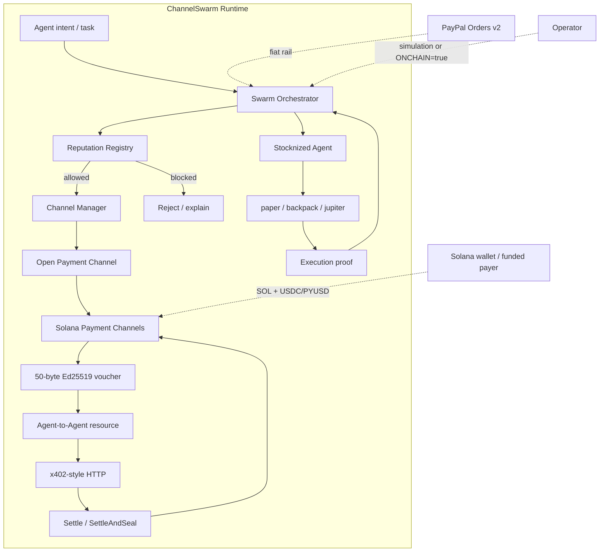

# ⚡ ChannelSwarm

> **Autonomous Agent Economy on Solana + PayPal**

<div align="center">

**Agents that can earn · spend · coordinate · settle**

[](https://solana.com/)
[](https://developer.paypal.com/)
[](https://www.typescriptlang.org/)
[](https://github.com/wadezigh96/Channel_Swarm/actions)
[](LICENSE)

[**Live Dashboard**](https://swarm-agent-beta.vercel.app/) · [**Payment Channels Program**](https://explorer.solana.com/address/CHNLxYvVA28MJP9PrFuDXccuoGXAx7jBacfLEkahyGsX) · [**Submission**](SUBMISSION.md)

</div>

---

## 🧠 What is ChannelSwarm?

**ChannelSwarm** is a Solana-native prototype for agent-to-agent payments with dual-rail settlement (Solana + PayPal).

It combines:

- ⚡ **Payment Channels** — signed cumulative vouchers for micropayments
- 🤖 **Agent Swarm** — payer, oracle and trading agents coordinating together
- 🛡️ **Reputation** — score-gated agent participation
- 💳 **x402-style payments** — HTTP payment-required flow using signed vouchers
- 📈 **Stocknized Agent** — tokenized-equity strategy with **paper default** and **opt-in live execution** (Backpack RFQ or Jupiter xStock swaps)
- 💵 **PYUSD support** — official PayPal USD mint on Solana (Token-2022)
- 💳 **PayPal Orders** — dual-rail fiat settlement via PayPal Orders v2 API

> **Honest status:** payment-channel wire format and demo lifecycle are implemented. Tokenized-equity **execution path** is complete (paper / backpack / jupiter) with local execution proofs; live fills require credentials and funded accounts. Local demo persistence is available via an optional file-based store (`data/` directory); production PayPal orders require Upstash Redis. The default mode is simulation.

---

## ✨ Product Surface

| Module | What it does |
|---|---|
| **Agent Economy** | Coordinates Alpha, DataOracle and StockHunter |
| **Payment Channels** | Opens channels and creates signed cumulative vouchers |
| **Settlement** | Builds `settle`, `settleAndSeal` and close instructions |
| **x402-style HTTP** | Returns `402 Payment Required` and verifies signed payments |
| **Reputation** | Gates participation using agent reputation |
| **Stocknized** | Pyth (or paper) quotes + `EXECUTION_MODE=paper\|backpack\|jupiter` |
| **PYUSD** | Official PayPal USD (mainnet + devnet mints) |
| **PayPal Orders** | Dual-rail fiat settlement |
| **Dashboard** | Dark, agent-first web dashboard with live PayPal button |

---

## 🔄 How it works

**Intent → Reputation → Payment Channel → Voucher → Agent Resource → Settlement**



### Runtime layers

| Layer | Responsibility |
|---|---|
| **Swarm Orchestrator** | Coordinates the agents and demo lifecycle |
| **Reputation** | Controls participation using agent scores |
| **Channel Manager** | Creates channels, vouchers and settlement paths |
| **Payment Channels** | Solana on-chain settlement primitive |
| **x402-style HTTP** | Payment-required resource flow using signed vouchers |
| **Stocknized Agent** | Strategy + unified execution path + proofs |
| **PayPal Client** | Dual-rail Orders v2 settlement |

## 💸 Payment Channel

The implementation uses the live Solana Payment Channels program:

```
CHNLxYvVA28MJP9PrFuDXccuoGXAx7jBacfLEkahyGsX
```

Voucher wire format:

```
50 bytes
├── 2 bytes   magic/version
├── 32 bytes  channel PDA
├── 8 bytes   cumulative amount
└── 8 bytes   expiry
```

Each voucher is authenticated with **Ed25519**.

### PYUSD (PayPal USD)

Official PYUSD mints (Token-2022, 6 decimals):

| Network | Mint |
|---------|------|
| Mainnet | `2b1kV6DkPAnxd5ixfnxCpjxmKwqjjaYmCZfHsFu24GXo` |
| Devnet  | `CXk2AMBfi3TwaEL2468s6zP8xq9NxTXjp9gjMgzeUynM` |

Enable with:
```bash
USE_PYUSD=true npm run demo
```

---

## 📈 Tokenized-equity execution

| Mode | Env | What happens |
|---|---|---|
| **paper** (default) | `EXECUTION_MODE=paper` | Simulated fills + local `ExecutionProof` |
| **backpack** | `EXECUTION_MODE=backpack` + API keys | STOCK RFQ submit → optional auto-accept → RFQ history proof |
| **jupiter** | `EXECUTION_MODE=jupiter` + mints + funded wallet | On-chain Jupiter swap of xStock mints → `txSignature` proof |

```bash
# Safe demo (always works without keys)
npm run demo:equity

# Backpack live (credentials + balance required)
EXECUTION_MODE=backpack BACKPACK_LIVE_TRADING=true BACKPACK_AUTO_ACCEPT_RFQ=true npm run demo:equity

# Jupiter live (mints + funded wallet required)
EXECUTION_MODE=jupiter USDC_MINT=... XSTOCK_AAPL_MINT=... npm run demo:equity
```

---

## 🤖 Agent Roster

| Agent | Role | Current mode |
|---|---|---|
| **Alpha** | Payment coordinator | Simulation / optional on-chain |
| **DataOracle** | Data signal provider | Demo |
| **StockHunter** | Strategy + stocknized layer | Paper default / opt-in live |

---

## 🧪 Current implementation status

| Capability | Status |
|---|:---:|
| 50-byte voucher + Ed25519 | ✅ |
| Deterministic channel PDA | ✅ |
| `open` instruction builder (SPL Token + Token-2022 ATA derivation) | ✅ |
| `settle` instruction builder | ✅ |
| `settleAndSeal` instruction builder | ✅ |
| `requestClose` path | ✅ |
| Agent swarm demo | ✅ |
| Reputation gating | ✅ |
| x402-style HTTP server | ✅ |
| Automated tests | ✅ |
| TypeScript build | ✅ |
| Tokenized-equity execution path (paper / backpack / jupiter + proofs) | ✅ |
| Local demo persistence for reputation / portfolio | ✅ optional file store |
| PYUSD mint identification and Token-2022 extension preflight | ✅ code + tests; funded mainnet test pending |
| PayPal Orders v2 create / lookup / approval-gated capture | ✅ code + mocked tests; sandbox E2E pending |
| PayPal webhook signature verification, deduplication, and partial-refund reconciliation | ✅ code + mocked tests; webhook registration/E2E pending |
| Durable order ledger and API rate limits | ✅ Upstash adapter; production credentials required |
| Rail advisor | ✅ rules fallback; optional AI Gateway needs configuration/model test |
| Funded mainnet lifecycle | Not executed; requires operator approval and funded wallet |

---

## 🚀 Quick Start

```bash
git clone https://github.com/wadezigh96/Channel_Swarm.git
cd Channel_Swarm
npm install
cp .env.example .env
# Fill PAYPAL_CLIENT_ID, PAYPAL_CLIENT_SECRET, and optionally SOLANA_PRIVATE_KEY

npm test
npm run demo
npm run demo:paypal
npm run demo:equity
```

For an on-chain payment-channel attempt:

```bash
# Fund the payer with SOL + USDC or PYUSD first.
ONCHAIN=true USE_PYUSD=true npm run demo
```

The default is simulation, so `npm run demo` needs no private key and sends no on-chain transaction. Only set `ONCHAIN=true` after checking the RPC, payer, mint, token extensions, balance, and fee budget. An explicit on-chain run requires a valid payer key, and any failed preflight stops the run rather than silently recording a simulated channel.

---

## 🖥️ Live Dashboard (Dual-Rail)

**https://swarm-agent-beta.vercel.app/**

The updated dashboard source includes a **Create PayPal Order** button that calls the serverless endpoint below. The public deployment will not show this updated flow until these changes are pushed and Vercel redeploys:

```
POST /api/paypal-order
```

Set these environment variables in Vercel (Project Settings → Environment Variables):

- `PAYPAL_CLIENT_ID`
- `PAYPAL_CLIENT_SECRET`
- `PAYPAL_MODE=sandbox`

After deployment, the create button writes a durable order record, opens the PayPal sandbox approval page, and captures only after PayPal returns an approved order. The order amount is checked again before capture. The API requires Upstash storage for the ledger and rate limits.

Configure these additional Vercel environment variables before enabling the PayPal flow:

- `UPSTASH_REDIS_REST_URL` and `UPSTASH_REDIS_REST_TOKEN` for durable orders, webhook deduplication, and rate limits.
- `PAYPAL_WEBHOOK_ID` after registering `https://<your-domain>/api/paypal-webhook` in the PayPal developer dashboard. Subscribe to `CHECKOUT.ORDER.APPROVED`, `CHECKOUT.ORDER.COMPLETED`, and relevant `PAYMENT.CAPTURE.*` events.
- `APP_URL=https://<your-domain>` so PayPal redirects back to your deployment.
- Optional `AI_GATEWAY_BASE_URL`, `AI_GATEWAY_API_KEY`, and `AI_GATEWAY_MODEL` for the advisor. Without these, deterministic rules are used. The advisor only recommends a rail; it cannot send a payment.

Keep `PAYPAL_MODE=sandbox`, `PAYPAL_ALLOW_LIVE=false`, and `PAYPAL_AUTO_ORDER=false` until sandbox end-to-end validation is complete. The swarm demo does not automatically create PayPal orders unless `PAYPAL_AUTO_ORDER=true`. Mainnet transactions are also opt-in with `ONCHAIN=true`; never add private keys to the repository or browser bundle.

---

## 🏗️ Architecture

```
src/
├── payments/
│   ├── channel-manager.ts
│   ├── instructions.ts
│   ├── pyusd.ts
│   ├── voucher.test.ts
│   ├── x402-server.ts
│   └── x402.test.ts
├── paypal/
│   └── paypal-client.ts
├── swarm/
│   └── orchestrator.ts
├── stock/
│   ├── stocknized-agent.ts
│   ├── jupiter-executor.ts
│   └── execution-mode.ts
├── execution/
│   ├── backpack-stock-client.ts
│   └── backpack-rfq-proof.ts
├── market/
│   └── pyth-client.ts
├── reputation/
│   └── reputation.ts
└── wallet.ts

examples/
├── demo-swarm.ts
├── equity-execution-demo.ts
├── stocklana-demo.ts
├── verify-backpack-stocks.ts
├── x402-demo.ts
└── paypal-swarm-demo.ts

api/
└── paypal-order.ts          ← serverless endpoint

docs/
└── index.html               ← live dashboard
```

---

## 🔐 Scope & limitations

- **Stocknized:** default is paper with local execution proofs. Live `backpack` / `jupiter` modes are opt-in and need credentials + funded accounts.
- **x402:** local x402-style transport, not a claim of full production x402 compatibility.
- **Persistence:** local reputation and portfolio data use an optional file store. The PayPal order ledger uses Upstash REST in Vercel and is disabled until configured.
- **On-chain payment channels:** opt-in with `ONCHAIN=true`; requires a funded payer and a token mint accepted by the program.
- **Default demo:** simulation-first to avoid sending doomed transactions.
- **PYUSD:** the client detects Token-2022 and checks mint extensions against the deployed program's allowlist before opening. A funded mainnet transaction has not been run; unsupported extensions fail closed to simulation.
- **PayPal:** sandbox Orders v2 create, lookup, capture, webhook signature verification, and ledger code are implemented. A registered sandbox webhook, Upstash, PayPal credentials, and end-to-end validation are still required for the deployed flow.
- **Rail advisor:** deterministic rules work without keys. AI Gateway mode requires a server-side base URL, key, model, and a separate model connectivity test.

---

## 📚 Links

- [Repository](https://github.com/wadezigh96/Channel_Swarm)
- [Live Dashboard](https://swarm-agent-beta.vercel.app/)
- [GitHub Actions](https://github.com/wadezigh96/Channel_Swarm/actions)
- [Submission](SUBMISSION.md)
- [Go-live checklist](GO_LIVE_CHECKLIST.md)
- [Integration references](docs/INTEGRATION_REFERENCES.md)
- [Solana Payment Channels](https://github.com/solana-foundation/payment-channels)
- [Program Explorer](https://explorer.solana.com/address/CHNLxYvVA28MJP9PrFuDXccuoGXAx7jBacfLEkahyGsX)
- [PYUSD on Solana](https://solana.com/pyusd)
- [PayPal Developer](https://developer.paypal.com/)

---

## 📄 License

MIT · Built for PayPal AI Hackathon 2026 + Solana
